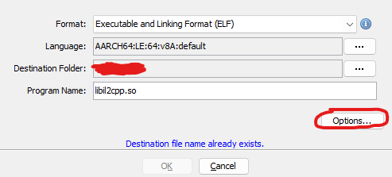
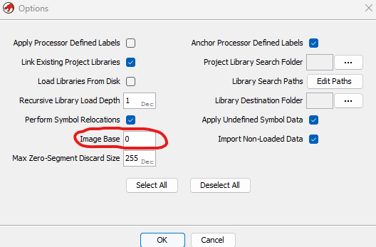
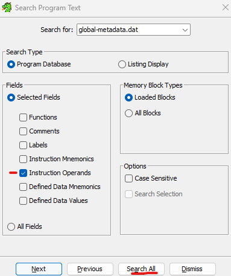
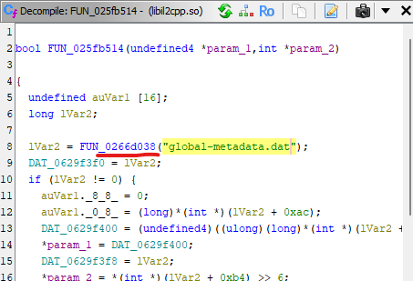

# Il2CppMetadataExtractor
Simple and easy to use [Frida](https://frida.re/) script for dumping decrypted Il2cpp global-metadata.dat files from a Unity application's memory, utilizing multiple methods. Tested on Android.

The extracted global-metadata.dat file plus it's corresponding libil2cpp.so file can be used with tools such as [Il2CppInspector](https://github.com/djkaty/Il2CppInspector)/[Il2CppInspectorRedux](https://github.com/LukeFZ/Il2CppInspectorRedux) and ultimately [Ghidra](https://github.com/NationalSecurityAgency/ghidra) or [IDA](https://hex-rays.com/) in order to aid in the reverse engineering of il2cpp Unity projects.

It is often the case that the global-metadata.dat file is encrypted, this tool allows you to dump a decrypted copy of the file; in the best case, using only the name of the target application.

**IMPORTANT**: By default this script will attempt to automatically determine the size and location of the metadata file. If this process takes too long and the program crashes before either can take place, follow the guide "[How to locate the offset](#how-to-locate-the-offset)" and/or specify the size manually. Size is typically the same as the encrypted file. It is also possible that the file will not be found by the default search pattern, in that case a custom pattern may be necessary.

## Usage
```sh
python dump-metadata.py [-h] [-o OFFSET] [-s SIZE] [-p PATTERN] package_name
```

```
positional arguments:
  package_name          Name of the target application ex: com.company.appname

options:
  -h, --help            show this help message and exit
  -o OFFSET, --offset OFFSET
                        Offset of a function which would return a pointer to the metadata file, see readme
  -s SIZE, --size SIZE  Manually specify the size of the file in bytes
  -p PATTERN, --pattern PATTERN
                        Manually specify a file search pattern (default: "af 1b b1 fa 1? 00 00 00 00")
```

Offset is an optional parameter, specifying the offset will grab the file using an alternative and faster method. Default behavior when offset is not specified is to search heap memory for the metadata file. The search pattern used for this task can be updated with the --pattern parameter. To locate the offset parameter, see "[How to locate the offset](#how-to-locate-the-offset)".

Example offset:
0x1234567

Pattern may need to be specified manually depending on Unity version. If finding a pattern that works proves difficult, it is suggested that the [offset](#how-to-locate-the-offset) method should be used at least for the first extraction. A pattern specific to the project/unity version can be gleaned from decrypted metadata files.

Size of the metadata file is given in bytes, default behavior is to automatically assess size, the --size option will bypass this assessment and manually set the file size.

## How to locate the offset
This example will use Ghidra, a similar process can be followed using IDA.

Step 1:
Locate the libil2cpp.so file in your project. In an Android project, it will be located in an APK file.

Step 2:
Create a new Ghidra project and add the file. Open the file in the editor, make sure to open options and set the image base to zero.





Step 3:
When opening the file for the first time, Ghidra will ask if you want to run the standard analysis on the file. Run the analysis and wait for it to finish completely.

Step 4:
Open the search function in Ghidra (ctrl + shift + E) and "Search All" for "global-metadata.dat". Ensure that you at least have "Instruction Operands" selected under "Fields" when you begin your search.



Eventually you should see a reference to "global-metadata.dat" in your search results. It may take a long time. Select that option and you will find a disassembled function that looks something like this:



The name of the function which is called with the file name as it's parameter is also the offset value you need. In this example it would be 0x266d038